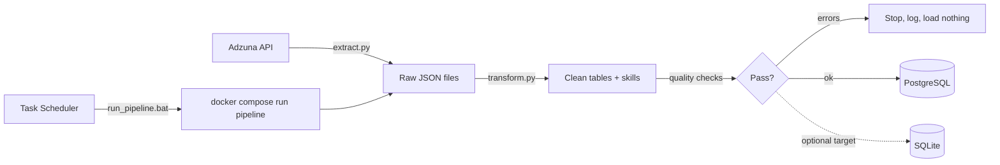

# Data Job Market Analysis( CV small personal project)

## Goal of the project
In modenr Data field, what skill and roles are in demand. A full project from basic analysis to automated pipeline and predictive model.

## Data
lukebarousse/data_jobs (Hugging Face), real data job postings
with 700000+ rows and 17 columns

https://huggingface.co/datasets/lukebarousse/data_jobs/viewer/default/train


## Tools
Python, pandas, matplotlib/seaborn, Jupyter, SQL, Git


## Info about the loaded dataset
- Salary_year_avg is missing in 97.2% of rows, so only about 3 in 100 postings have a yearly salary.
- Job_skills is missing in only 14.9% of rows, so most postings have skills listed.
- Titles, dates, and countries have 0% missing. job_schedule_type (1.6%) and job_location (0.1%) are minor.
- The US dominates with 206,292 rows (about 26%), followed by India, the UK, France, and Germany.

- Found some row has search_location = Sudan, but the actual job_location values are US cities (Phoenix, Houston, San Francisco) or "Anywhere" (remote). None of these jobs is in Sudan.

Data quality note: job_country reflects the search query, not the job's actual location. About 98% of rows labeled "Sudan" had US or remote locations, so they were excluded from country-level analysis.

A first location-format check flagged the UK, but inspection showed it was a pattern artifact; a stricter check confirmed only Sudan was affected

## Business questions 

- Which skills are most requested for Data Analyst roles globally, and how does Malaysia compare?

- How do the top skills differ between Data Analyst, Data Engineer, and Data Scientist?

  **SQL is the common thread. It's in 58% of Analyst, 67% of Engineer, and 54% of Scientist postings. It's the one skill that pays off whichever way your career goes.

  **Python grows as you move toward engineering and science. It's 36% for Analysts, 64% for Engineers, and 78% for Scientists. It's the second skill to learn, and the one that makes your later stages possible.

  **Excel and BI tools are analyst territory. Excel is 42% for Analysts but only 5% for Engineers and 12% for Scientists. Power BI is 25% for Analysts vs about 11% for the other two. Tableau is also strongest for Analysts (29%).


- How has demand for each role changed over time?
   One year of data (2023) can show seasonality but not trend; the January peak may be a collection artifact

- What share of postings are remote or mention no degree requirement, by role --Eg: in malaysia--?
  **Remote work is rare in Malaysia. Only 1.5-2.7% of core-role postings are flagged as work from home. Local employers mostly want people in the office.
  **Data Scientist postings mention degrees far more often. Only 8.9% don’t mention a degree, vs 32.3% for Analysts and 36.9% for Engineers. A plausible reading is that science roles lean harder on formal qualifications, while analyst and engineer roles are more open to portfolios and skills


SQL results match pandas exactly (SQL at 58.0%, Excel at 41.9%, and so on), cross-checked the analysis two ways.

## Dashboards


https://public.tableau.com/app/profile/imran.sajawal/viz/Jobanalysis_17948999525800/Dashboard1?publish=yes

## Findings
- SQL appears in 58% of Data Analyst postings, the top skill, and is the only skill that ranks highly for all three roles.
- Python rises from 36% (Analyst) to 64% (Engineer) and 78% (Scientist).
- Cloud and big-data tools (AWS, Azure, Spark) are roughly 5-10x more common in Engineer postings than Analyst ones.
- In Malaysia, Excel is mentioned more often than globally (50% vs 42% of Analyst postings), and remote work is rare (under 3% of core-role postings).
- Limitations: one year of data (2023), country labels reflect the search query (Sudan excluded), salary covers about 3% of postings and is mostly US, “no degree mentioned” doesn’t    mean “no degree required.”


Adzuna returns descriptions truncated to ~500 characters, so only 12% of postings had a detectable skill. Skill percentages from the pipeline are lower bounds and are not comparable with the full-description Stage 1 data.


# Data Job Market: From Analysis to Pipeline

An end-to-end data project that asks one question: **which skills and roles are in demand in the data field, and what should an aspiring data analyst learn first?**

It is built in three stages that follow a career path from analyst to engineer to scientist.

| Stage | Role | What it delivers | Status |
|---|---|---|---|
| 1 | Data Analyst | Cleaning, SQL and pandas analysis, Tableau dashboard on 785k job postings | Done |
| 2 | Data Engineer | Automated pipeline: Adzuna API to PostgreSQL, run in Docker | Done (live scheduled extraction pending an Adzuna paid plan, see [Limitations](#limitations)) |
| 3 | Data Scientist | Predictive / clustering model on the Stage 1 data | Planned |

**Live dashboard:** [Tableau Public link here]


---

## Stage 1: Analysis

**Data:** `lukebarousse/data_jobs` (Hugging Face), 785,741 data job postings from 2023, 17 columns.

**Tools:** Python (pandas, matplotlib, seaborn), SQLite, SQL (CTEs, window functions), Tableau Public.

### Business questions and findings

1. **Which skills do Data Analyst postings ask for most?**
   SQL appears in 58.0% of postings that list skills, followed by Excel (41.9%), Python (35.9%), Tableau (29.1%) and Power BI (24.8%). Results were cross-checked in pandas and SQL and matched exactly.

2. **How do skills differ between Analyst, Engineer and Scientist roles?**
   SQL is the only skill that ranks highly for all three roles (58% / 67% / 54%). Python rises from 36% (Analyst) to 64% (Engineer) and 78% (Scientist). Cloud and big-data tools are roughly 5 to 10 times more common in Engineer postings than Analyst ones (for example Spark 31.6% vs 3.2%). Excel and BI tools are analyst territory.

3. **Which skills are linked to higher pay?** (US, Data Analyst, about 3% of postings carry a salary)
   The overall median is $90,000 before removing likely reposts. SQL and Power BI sit at that baseline, Python ($97,500) and Tableau ($93,000) are above it, and Excel ($84,392) is below. Cloud and big-data skills show the largest premiums, but this most likely reflects more technical roles rather than an effect of the skill itself. About 10% of salaried postings (374 of 3,867) were flagged as probable reposts, and the dashboard uses the de-duplicated figures.

4. **How has demand changed over time?**
   The data covers one year (2023), so it can show seasonality but not a trend. Postings peak in January and fall afterwards. This may partly reflect how the data was collected, so the dashboard labels it as a possible collection artifact.

5. **How common are remote work and "no degree" postings?**
   In Malaysia only 1.5 to 2.7% of core-role postings are flagged as remote. Postings that do not mention a degree are far less common for Data Scientists (8.9%) than for Analysts (32.3%) or Engineers (36.9%). "No degree mentioned" is not the same as "no degree required".

### Malaysia comparison

Malaysia has 9,218 postings in the data, with locations in Kuala Lumpur, Petaling Jaya, Penang, Cyberjaya and elsewhere. For Data Analyst roles, Excel is mentioned more often than globally (50.4% vs 41.9%) and SAP too (12.1% vs 7.1%), while SQL is slightly lower (54.0% vs 58.0%). Python, Tableau and Power BI are within about 2 points of the global figures.

---

## Stage 2: Data pipeline

A pipeline that pulls fresh Singapore data job postings from the Adzuna API, cleans them, checks their quality and loads them into a database without creating duplicates.

### Architecture



**Tools:** Python (requests, pandas, psycopg2), PostgreSQL 16, SQLite, Docker and Docker Compose, Windows Task Scheduler.

### How each step works

- **Extract** (`extract.py`): calls the Adzuna search API for three queries (data analyst, data engineer, data scientist), keeps only postings from the last 30 days, retries on temporary errors with exponential backoff, and saves every response as a timestamped raw JSON file. Raw data is never edited.
- **Transform** (`transform.py`): parses dates and salaries, labels roles from titles, extracts skills by regex matching against a keyword list, removes duplicate job IDs, and flags (but does not delete) probable reposts with the same title and company. It re-reads all raw files, so it can be re-run without any API calls.
- **Quality checks** (`pipeline.py`): errors stop the run before anything is loaded (empty result, null or duplicate job IDs, unparseable or future dates, orphaned skill rows). Warnings are logged without stopping (too many unclassified titles, inconsistent salary scale, too many old postings).
- **Load** (`load_pg.py`, `load.py`): an upsert keyed on `job_id`, wrapped in one transaction, so running the pipeline twice gives the same result as running it once. Verified: repeated runs keep the warehouse at the same row counts.
- **Orchestration**: a `--skip-extract` flag re-processes saved data with no API calls, and `WAREHOUSE=postgres|sqlite` in `.env` selects the target database. `run_pipeline.bat` runs the containerised pipeline from Windows Task Scheduler.

### Current warehouse

From four raw extracts (400 raw rows): **318 unique jobs** and **119 job-skill rows**, with the roles Data Scientist (86), Data Engineer (83), Data Analyst (73), Senior Data Analyst (43), Senior Data Engineer (17), Senior Data Scientist (14), Business Analyst (1) and Other (1).

---

## Data quality decisions

| Problem found | Evidence | Decision |
|---|---|---|
| `job_country` in the Stage 1 data reflects the search term, not the job location | 21,781 rows labelled "Sudan"; about 98% had US or remote locations | Excluded Sudan from country-level analysis, kept the raw data untouched |
| A first location check flagged the UK | The pattern matched "London, UK" as a US state code | Treated as an artifact of the check, not a data problem |
| Salary is sparse in Stage 1 | Only about 3% of postings have a yearly salary, 82% of those are US | Salary findings are limited to the US and described as indicative |
| Likely reposts inflate salary results | 374 of 3,867 US analyst postings had the same title, company and salary | De-duplicated before computing medians |
| Adzuna descriptions are truncated | Every description is capped at about 500 characters | Skill counts from this source are treated as lower bounds |
| Adzuna salaries for Singapore are unreliable | Values range from 6 to 300,000 with no consistent unit, many identical ranges across employers, and the raw JSON matched the cleaned data | Stored as `salary_status = 'unverified'` and excluded from analysis, with a pipeline warning |
| Old postings in early extracts | Postings dated back to 2024 appeared before a date filter was added | Added `max_days_old=30` to the extract and a freshness warning |
| Role labels missed "Data Science" titles | 10 rows landed in "Other" | Added a title rule, an upsert corrected the existing rows without duplicating them |

---

## Repository structure

```
.
├── README.md
├── load_data.py                 # Stage 1: download the dataset
├── analysis.ipynb               # Stage 1: cleaning and analysis
├── sql/                         # Stage 1: SQL queries
├── dashboard/                   # Stage 1: dashboard data exports and screenshot
├── extract.py                   # Stage 2: API extraction
├── transform.py                 # Stage 2: cleaning and skill extraction
├── load.py                      # Stage 2: SQLite loader
├── load_pg.py                   # Stage 2: PostgreSQL loader
├── pipeline.py                  # Stage 2: orchestration, logging, quality checks
├── Dockerfile
├── docker-compose.yml
├── requirements.txt             # Stage 1 environment
├── requirements-pipeline.txt    # Stage 2 container dependencies
├── run_pipeline.bat             # Windows Task Scheduler entry point
└── .env.example
```

Not tracked (see `.gitignore`): `.env`, `data/`, `logs/`, the virtual environment, and the SQLite database.

---

## How to run

### Stage 1

```bash
python -m venv venv
venv\Scripts\activate            # Windows (Mac/Linux: source venv/bin/activate)
pip install -r requirements.txt
python load_data.py
```

Then open `analysis.ipynb` and run the cells in order.

### Stage 2

Requires Docker Desktop and an Adzuna API key from the Adzuna developer portal.

1. Copy `.env.example` to `.env` and fill in the values:

   ```
   ADZUNA_APP_ID=your_app_id
   ADZUNA_APP_KEY=your_app_key
   POSTGRES_USER=pipeline
   POSTGRES_PASSWORD=choose_a_password
   POSTGRES_DB=jobs
   ```

2. Start the database:

   ```bash
   docker compose up -d
   ```

3. Run the pipeline in a container:

   ```bash
   docker compose run --rm pipeline python pipeline.py
   ```

   To re-process data already saved in `data/raw/` without calling the API:

   ```bash
   docker compose run --rm pipeline python pipeline.py --skip-extract
   ```

4. Inspect the results:

   ```bash
   docker compose exec db psql -U pipeline -d jobs -c "SELECT job_title_short, COUNT(*) FROM jobs GROUP BY 1 ORDER BY 2 DESC;"
   ```

A fresh clone has no raw data (it is not stored in the repository), so the first run needs a working API key.

Logs are written to `logs/pipeline.log`. On Windows, `run_pipeline.bat` can be scheduled with Task Scheduler.

---

## Limitations

- **Live extraction needs a paid Adzuna plan.** The free key allows only a small number of test calls, so the pipeline currently runs on the extracts already collected. The scheduled task uses the `--skip-extract` mode until a paid plan is active.
- **Skills from Adzuna are under-counted** because descriptions are truncated. They are not directly comparable with the Stage 1 percentages.
- **Salary data is not used from Adzuna** (unverified), and Stage 1 salary findings cover about 3% of postings and are mostly US.
- **Stage 1 covers one year (2023),** so seasonality is visible but trends are not.
- **Country labels in the Stage 1 data are search-based.** Sudan was excluded, and the check for other countries used a heuristic, so small errors elsewhere are possible.
- **The scheduler needs the computer on and Docker Desktop running.** Moving the pipeline to an always-on host is a next step.

## Roadmap

- Stage 3: model built on the Stage 1 data (skill-based clustering of roles, or predicting whether a posting lists a salary).
- Add a second job source and normalise it into the same schema.
- Move the scheduled run to an always-on host.
- Re-point the Stage 1 SQL at PostgreSQL and use its built-in median function.

## Data sources and credits

- Stage 1: `lukebarousse/data_jobs` dataset on Hugging Face.
- Stage 2: job data from the Adzuna API. Check Adzuna's terms of use for attribution and usage requirements.